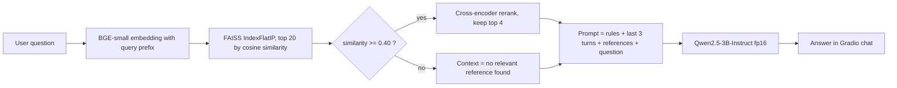
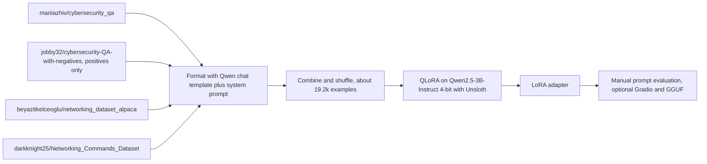

<div align="center">

# 🛡️ Cybersecurity & Networking Assistant

**A RAG chatbot and a fine-tuned Qwen2.5 model for beginner-friendly cybersecurity and networking Q&A, built and tested entirely on a free Google Colab T4 GPU.**

-orange)


-purple)


[](https://colab.research.google.com/github/YOUR_USERNAME/YOUR_REPO/blob/main/notebooks/cyber_networking_rag_chatbot_colab_4DS_11KDS.ipynb)
[](https://colab.research.google.com/github/YOUR_USERNAME/YOUR_REPO/blob/main/notebooks/qwen2_5_3b_cyber_networking_v2_complete.ipynb)

</div>

---

## Table of contents

1. [Overview](#1-overview)
2. [Why this project exists](#2-why-this-project-exists)
3. [Architecture](#3-architecture)
4. [Knowledge base](#4-knowledge-base)
5. [The RAG chatbot in detail](#5-the-rag-chatbot-in-detail)
6. [The fine-tuned model in detail](#6-the-fine-tuned-model-in-detail)
7. [Design decisions and the reasoning behind them](#7-design-decisions-and-the-reasoning-behind-them)
8. [How the project evolved (lessons learned)](#8-how-the-project-evolved-lessons-learned)
9. [Evaluation](#9-evaluation)
10. [Quickstart](#10-quickstart)
11. [Using the fine-tuned adapter inside the RAG chatbot](#11-using-the-fine-tuned-adapter-inside-the-rag-chatbot)
12. [Known limitations](#12-known-limitations)
13. [Roadmap](#13-roadmap)
14. [Troubleshooting](#14-troubleshooting)
15. [Responsible use](#15-responsible-use)
16. [Repository structure](#16-repository-structure)
17. [Acknowledgements, license and author](#17-acknowledgements-license-and-author)

---

## 1. Overview

This repository contains two Colab notebooks that attack the same problem from two different angles: **getting a small open-source LLM to answer cybersecurity and networking questions accurately, in plain language, without making things up.**

| | 🔎 RAG chatbot | 🎓 Fine-tuned model |
|---|---|---|
| **Notebook** | `notebooks/cyber_networking_rag_chatbot_colab_4DS_11KDS.ipynb` | `notebooks/qwen2_5_3b_cyber_networking_v2_complete.ipynb` |
| **Idea** | Look up relevant Q&A pairs at question time and hand them to the LLM | Bake domain vocabulary and answer style into the model weights |
| **LLM** | Qwen2.5-3B-Instruct, fp16 | Qwen2.5-3B-Instruct, 4-bit, QLoRA |
| **Data** | 27,218-entry knowledge base from 5 sources | about 19.2k training examples from 4 datasets |
| **Output** | Gradio chat app with a shareable link | LoRA adapter (optional Gradio app and GGUF export) |
| **Updating knowledge** | Add rows, rebuild the index | Retrain |

The notebooks are self-contained, run top to bottom, and fit on a free T4 (about 15 GB VRAM).

---

## 2. Why this project exists

**The learning curve is steep.** Cybersecurity and networking come with a lot of jargon, hundreds of commands and flags, and pairs of concepts that beginners constantly mix up (a SYN *scan* versus a SYN *flood*, the three-part CIA triad versus extended models, and so on). Learners need plain-language explanations that they can trust.

**Small LLMs make things up, and in security that is dangerous.** In our own tests a 3B model happily explained a Cisco command that does not exist (`show hackers`) and invented a "fourth pillar" of the CIA triad. A made-up flag or command is worse than no answer, because someone might run it.

**There are two standard remedies, and it is not obvious which is better.**
- *Retrieval-Augmented Generation (RAG)* grounds the model in a curated knowledge base at question time.
- *Fine-tuning* teaches the model the domain's vocabulary and answer style.

Which one works better for a small model, and whether they combine well, is an empirical question. This project builds both under identical constraints and records what actually happened, including what did not work.

**Hardware is a real constraint.** Everything here is designed for a free Colab T4: a 3B model, 4-bit QLoRA training, small embedding models and a CPU FAISS index. No paid API and no paid GPU.

**Goals**
1. Beginner-friendly answers grounded in a curated knowledge base.
2. Reduce (not eliminate) invented commands, flags and facts.
3. Reproducible on free hardware, with every decision documented.
4. Honest evaluation, including failures.

**Non-goals**
- This is not an offensive-security tool.
- It is not a substitute for official documentation.
- It is not a rigorous benchmark (see [Evaluation](#9-evaluation) for the caveats).

---

## 3. Architecture

### RAG chatbot



### Fine-tuning



### Components

| Component | Choice | Role |
|---|---|---|
| Embedding model | `BAAI/bge-small-en-v1.5` | Turns questions and KB entries into vectors |
| Vector index | FAISS `IndexFlatIP` on normalized vectors | Exact cosine-similarity search |
| Reranker | `cross-encoder/ms-marco-MiniLM-L-6-v2` | Re-scores the top 20 candidates for relevance |
| Chat LLM | `Qwen/Qwen2.5-3B-Instruct` (fp16) | Writes the final answer from the retrieved context |
| Fine-tune base | `unsloth/Qwen2.5-3B-Instruct` (4-bit) | Starting point for QLoRA |
| Training stack | Unsloth, TRL `SFTTrainer`, PEFT | Fast, memory-efficient LoRA training |
| UI | Gradio `ChatInterface` | Chat app with a temporary public link |

---

## 4. Knowledge base

The RAG notebook merges one private CSV collection and four public Hugging Face datasets into a single table with the columns `question`, `answer`, `source` and `search_text`.

| Source key | Origin | Raw rows | After cleaning | Share of KB |
|---|---|---:|---:|---:|
| `local_csv` | Own Q&A dataset (13 CSV files with `question` and `answer` columns; **not included** in this repo) | 11,149 | 8,220 | 30.2% |
| `cyber_neg` | [`jobby32/cybersecurity-QA-with-negatives`](https://huggingface.co/datasets/jobby32/cybersecurity-QA-with-negatives) | 17,263 | 17,000 | 62.5% |
| `cyber_qa` | [`mariiazhiv/cybersecurity_qa`](https://huggingface.co/datasets/mariiazhiv/cybersecurity_qa) | 502 | 501 | 1.8% |
| `net_alpaca` | [`beyazitkelceoglu/networking_dataset_alpaca`](https://huggingface.co/datasets/beyazitkelceoglu/networking_dataset_alpaca) | 750 | 747 | 2.7% |
| `net_cmds` | [`darkknight25/Networking_Commands_Dataset`](https://huggingface.co/datasets/darkknight25/Networking_Commands_Dataset) | 750 | 750 | 2.8% |
| **Total** | | **30,414** | **27,218** | 100% |

### How each source is turned into Q&A pairs

- **Alpaca-style datasets** (`cyber_qa`, `net_alpaca`): `instruction` (plus `input` if present) becomes the question, `output` becomes the answer.
- **`cyber_neg`**: `question` and `positive` are used. The `hard_negative` and `soft_negative` columns are deliberately ignored, because they are wrong answers meant for retrieval or contrastive training and would poison a knowledge base.
- **`net_cmds`**: the command, purpose, usage, category and risk fields are combined into one structured answer ("Command / Purpose / Usage / Category / Risk"). A dedicated `search_text` (command + description + usage + category) is embedded so command lookups match well.
- **Auto-detection**: the loader recognizes many column names (`question`/`query`/`anchor`, `answer`/`positive`/`output`, chat-style `messages`, 0/1 label columns) and prints the mapping it chose, so you can verify it.

### Cleaning

1. Drop rows with a question shorter than 5 characters or an answer shorter than 10 characters.
2. Drop rows where the question equals the answer.
3. Remove exact duplicates (same question **and** same answer). Same question with a different answer is kept.

Result: 30,414 → 27,218 entries.

### Known noise (see [limitations](#12-known-limitations))

A few `local_csv` rows are meta-questions rather than knowledge (for example, "What is the most common cybersecurity question people ask?" whose answer is itself a question), some answers are two words long ("Malicious software."), and some questions appear twice with different answers.

---

## 5. The RAG chatbot in detail

**Embedding.** Each KB entry is embedded as its `search_text` if it has one, otherwise `question + first 300 characters of the answer`. Queries get the BGE instruction prefix (`Represent this sentence for searching relevant passages: `). Vectors are normalized, so inner product equals cosine similarity.

**Retrieval** (`retrieve(query, top_k=4, fetch_k=20, min_score=0.40, source_filter=None)`):
1. Fetch the 20 nearest entries.
2. Drop anything below cosine similarity 0.40.
3. Re-score the survivors with the cross-encoder (question plus the first 400 characters of the answer) and keep the best 4.
4. If nothing survives, the prompt says so explicitly instead of passing unrelated context.

**Prompting.** The system prompt asks the model to:
- explain in simple language for beginners,
- treat the retrieved reference as its primary knowledge and stay consistent with it,
- fall back to general knowledge only when the reference is missing, and say so,
- never invent commands, flags or facts,
- keep answers to about 250 words,
- give defensive and educational guidance only,
- not list dataset sources.

The last 3 conversation turns are included so follow-up questions work. Each reference answer is truncated to 1,200 characters.

**Generation.** `temperature=0.4`, `top_p=0.9`, `max_new_tokens=600`.

**Index caching.** The FAISS index can be saved to Google Drive together with an MD5 hash of the KB text and the embedding model name. If the data or model changes, the hash no longer matches and the index is rebuilt. If Drive is not available the notebook simply rebuilds the index every run.

**Sample retrieval output** (from the notebook's own smoke tests):

```text
🔎 what does the command ip pim bidir-enable do
   [net_cmds   | sim=0.862 | rr=9.86] What does the networking command `ip pim bidir-enable` do?
   [net_alpaca | sim=0.921 | rr=9.04] Explain the networking command: ip pim bidir-enable
```

---

## 6. The fine-tuned model in detail

**Method.** QLoRA: the base model is frozen and loaded in 4-bit, and small LoRA adapter matrices are trained on top. Only the adapter (tens of MB) is saved.

| Setting | Value |
|---|---|
| Base model | `unsloth/Qwen2.5-3B-Instruct` (4-bit) |
| LoRA rank / alpha / dropout | 16 / 16 / 0 |
| LoRA target modules | `q_proj, k_proj, v_proj, o_proj, gate_proj, up_proj, down_proj` |
| Max sequence length | 4096 |
| Batch size | 2 per device × 4 gradient accumulation = 8 effective |
| Epochs | 2 |
| Learning rate / schedule | 2e-4, linear, 10 warmup steps |
| Optimizer | AdamW 8-bit, weight decay 0.01 |
| Precision | fp16 on T4 (bf16 automatically where supported) |
| Gradient checkpointing | Unsloth mode |
| Seed | 3407 |
| Chat template | Unsloth `qwen-2.5` |

**Training data** (the `train` split of each dataset):

| Dataset | Examples | Share |
|---|---:|---:|
| `mariiazhiv/cybersecurity_qa` | 401 | 2.1% |
| `jobby32/cybersecurity-QA-with-negatives` (positives only) | 17,263 | 90.1% |
| `beyazitkelceoglu/networking_dataset_alpaca` | 750 | 3.9% |
| `darkknight25/Networking_Commands_Dataset` | 750 | 3.9% |
| **Total** | **19,164** | 100% |

That works out to roughly 4,800 optimizer steps for 2 epochs (computed from the numbers above, not measured).

**Formatting.** Every example is a chat: a system prompt asking for detailed answers, the question, and the answer. For the commands dataset, the answer merges description, usage, category and risk so it is richer than the one-line description alone.

**Built-in diagnostic.** Before training, a cell reports the average answer length (in tokens) of each dataset and warns if it is under 25 tokens. This exists because of the first attempt (see [lessons learned](#8-how-the-project-evolved-lessons-learned)).

**Outputs.** LoRA adapter folder `qwen2.5-3b-cyber-networking-v2-lora/`. Optional cells push it to the Hub, launch a streaming Gradio app, or export a merged 16-bit / GGUF (`q4_k_m`) model.

---

## 7. Design decisions and the reasoning behind them

| Decision | What else was possible | Why this choice |
|---|---|---|
| **Fine-tune Qwen2.5-3B-*Instruct*, not the base 3B** | Fine-tune the base model and teach it to follow instructions ourselves | The Instruct model already knows chat format and instruction following. With only a few thousand domain examples, a base model would have to learn *both* instruction following and the domain, and would end up a weaker, more brittle assistant. |
| **3B parameters** | 7B or larger | A 3B model in 4-bit trains comfortably on a free T4 and runs in fp16 for chat. Larger models are a roadmap item (see the results: generator size mattered a lot). |
| **QLoRA instead of full fine-tuning** | Full fine-tune | Full fine-tuning does not fit in T4 memory. LoRA trains about 1% of the parameters, produces a small adapter, and is much less likely to erase general abilities. |
| **All 4 datasets in one training run** | Train on dataset A, then continue on dataset B | The first attempt trained sequentially, and the second stage pulled the model toward the second dataset's style. Mixing everything in one run avoids that overwrite. |
| **Ignore negatives in `jobby32`** | Use them for DPO or contrastive learning | Plain SFT only needs the correct answer. Training on `hard_negative` as if it were an answer would teach wrong facts. |
| **Merge fields for the commands dataset** | Use only `description` | The description alone is one short sentence, which taught the model to answer command questions in one line. Adding usage, category and risk gives richer targets. |
| **2 epochs, LR 2e-4** | 3+ epochs | Many answers are short and templated. Fewer epochs reduce the risk of memorizing templates word for word. |
| **System prompt asking for detail** | No system prompt | Nudges the model toward longer answers. It only helps if the training answers are also detailed, which is why the length diagnostic exists. |
| **`max_seq_length=4096`** | 2048 | Leaves room for long answers. (2048 is probably enough for this data and would train faster.) |
| **BGE-small with query prefix** | `all-MiniLM-L6-v2` (used in the first version) | BGE is stronger at query-to-passage retrieval, and an early test showed a paraphrased question failing to reach the right entry with MiniLM. |
| **Cross-encoder reranking** | Bi-encoder scores only | Bi-encoders are fast but coarse. A cross-encoder reads question and answer together and reorders the shortlist much more accurately. |
| **Similarity threshold 0.40** | Always pass the top-k | Stops unrelated snippets from being fed to the LLM, which otherwise tends to weave them into the answer. |
| **Exact `IndexFlatIP` index** | IVF / HNSW / a managed vector DB | With about 27k vectors, exact search is instantaneous and needs no extra infrastructure. |
| **"Do not list sources" in the prompt** | Show `[Source: ...]` tags | The tags are useful to the model as context but noisy for a beginner reading the answer. |
| **Answers capped near 250 words** | Unlimited | Keeps answers digestible for beginners and generation time reasonable on a T4. |

---

## 8. How the project evolved (lessons learned)

1. **v1: sequential fine-tune (cybersecurity data first, networking data second).** The networking stage showed a flat training loss of roughly 0.08 to 0.16 from the very first steps, and the model started giving one-line answers.
2. **Diagnosis.** The loss was not misbehaving. The model had simply learned what the data taught: the two networking datasets had templated one-line answers ("The command 'x' is used for: ..."), and the commands dataset was only using its short `description` field. *Models copy the length and style of their training targets.*
3. **v2 (this repo's fine-tuning notebook).** Combine all datasets in one run, enrich the commands answers with more fields, add a system prompt, lower the epochs, and add the answer-length diagnostic.
4. **RAG.** Started with a small MiniLM + FAISS retriever over the private CSV, then grew into the multi-source KB with BGE, a reranker, a threshold and chat history.
5. **Combining both.** Attaching the v2 adapter to the RAG chatbot did *not* beat the plain base model (details below). A larger generator helped more than the fine-tune did.

The main takeaways: **data format and answer length drive fine-tuned behaviour, retrieval quality drives RAG behaviour, and generator size drives how well the model follows context and rejects false premises.**

---

## 9. Evaluation

> ⚠️ **Read this first.** These are small, informal, manual tests: one sample per question, sampled decoding at temperatures between 0.1 and 0.7, and grading against known facts by hand. They are useful for spotting failure patterns, **not** for claiming benchmark numbers. Runs A to D used earlier iterations of the pipeline (an 11k-row KB and a MiniLM retriever), **not** the current 27k-entry BGE + reranker notebook, which has not been re-evaluated yet.

| Setup | Test | Observations |
|---|---|---|
| **A. Fine-tuned 3B, no retrieval** | About 11 prompts (cybersecurity, networking, off-domain) at T=0.7 and T=0.1 | Core facts mostly correct (SQL injection, TCP vs UDP, phishing). No visible forgetting (capital of France and a poem were fine). Command questions (`nmap -sS`, `traceroute`) still got one-line answers phrased almost like the training rows. At T=0.7 the model added "non-repudiation" as a fourth CIA pillar; at T=0.1 it did not, so the error is sampling-sensitive. |
| **B. Base 3B + RAG** | 20 questions in 8 categories (direct, paraphrase, out-of-KB, multi-hop, false-premise traps, exact facts, short queries, off-domain) | 10 correct, 7 partly inaccurate, 3 wrong. Wrong: a "SYN packets to every port" question answered as a SYN flood; an invented fourth CIA pillar; the fake `show hackers` command explained. It correctly rejected a fake `nmap --ghost-mode` flag. |
| **C. Fine-tuned 3B + RAG** | 6 hardest questions × 3 runs | Not better than B. Answers shrank to 1–3 sentences, the model sometimes overrode correct retrieved context (invented a pillar even when three CIA-triad entries were retrieved), explained the fake command, and produced runaway generation (continuing with made-up Q&A blocks) in 2 of 3 runs. |
| **D. Qwen2.5-7B-Instruct (4-bit, no adapter) + RAG** | 10 new questions (different from B, so not directly comparable) | 7 correct, 3 partly inaccurate, 0 wrong. It correctly rejected both traps (`ipconfig /hackcheck` and a "completely undetectable" nmap flag). Remaining errors: generic golden-ticket detection advice, FTP data port stated as 20 or 22, and a weak SSH-hardening list. |

### Takeaways

1. **Generator size mattered more than this fine-tune** for staying grounded and rejecting false premises.
2. **The fine-tuned 3B model inherited its data's flaws**: short, templated answers. Behaviour followed the training targets, not the system prompt.
3. **Retrieval works well when the question sits close to a KB entry.** It is weaker for paraphrases and for "how do I detect X" questions. When a KB answer is only two words, the LLM's own knowledge does most of the work.
4. **A similarity threshold alone cannot catch fake commands**, because a fake query still retrieves its nearest neighbours with moderate scores. Catching them needs an explicit check (for example, does the quoted command literally appear in the KB?).

### Suggested protocol for the next evaluation

Re-run the same fixed question suite on the current pipeline, with the same seed and low temperature (0.1–0.2), log the retrieved rows and scores next to every answer, and grade each answer as correct / partly inaccurate / wrong. Compare base and adapter by toggling the adapter on the same loaded model.

<details>
<summary><b>The 20-question suite used for setup B (click to expand)</b></summary>

| # | Category | Question |
|---|---|---|
| 1 | Direct | What is a SQL injection attack and how can it be prevented? |
| 2 | Direct | Explain the CIA triad in cybersecurity. |
| 3 | Direct | What does the 'nmap -sS' command do? |
| 4 | Direct | What is the difference between TCP and UDP? |
| 5 | Paraphrase | How do attackers trick employees using fake emails that look like they're from the bank? |
| 6 | Paraphrase | Why would someone send SYN packets to every port on a machine without completing the connection? |
| 7 | Paraphrase | Which tool shows me every router my packets pass through to reach a website? |
| 8 | Out-of-KB | What is Kerberoasting and how can defenders detect it? |
| 9 | Out-of-KB | Explain BGP hijacking and how RPKI helps prevent it. |
| 10 | Out-of-KB | Compare IPsec and WireGuard for site-to-site VPNs. |
| 11 | Multi-hop | How would you detect and respond to a port scan happening on your network? |
| 12 | Multi-hop | If a web app is vulnerable to SQL injection, which layers of defense (code, network, monitoring) should be added? |
| 13 | Trap | What is the fourth pillar of the CIA triad? |
| 14 | Trap | What does the 'nmap --ghost-mode' flag do? |
| 15 | Trap | Explain the Cisco IOS command 'show hackers'. |
| 16 | Exact facts | Which default ports do SSH, Telnet, HTTPS, and RDP use, and which of them are unencrypted? |
| 17 | Short query | firewall |
| 18 | Short query | DNS poisoning |
| 19 | Off-domain | What is the capital of France? |
| 20 | Long-form | Walk me through securing a small office network step by step. |

</details>

---

## 10. Quickstart

Both notebooks are designed for **Google Colab with a T4 GPU**: *Runtime → Change runtime type → T4 GPU*.

### 10.1 RAG chatbot

1. Open `notebooks/cyber_networking_rag_chatbot_colab_4DS_11KDS.ipynb` in Colab.
2. Run the cells from top to bottom.
3. When the upload widget appears, select your Q&A CSV file(s). Each needs `question` and `answer` columns. To use only the Hugging Face datasets, set `USE_LOCAL_CSV = False`.
4. The four Hugging Face datasets download automatically; the notebook prints the column mapping it chose for each.
5. The first run embeds all entries (about 213 batches of 128 for 27k entries) and builds the index.
6. The last cell launches the Gradio chat and prints a public link (temporary, best effort about one week).

**Settings you can change** (second code cell):

| Setting | Default | Meaning |
|---|---|---|
| `USE_LOCAL_CSV` | `True` | Include your own CSV files in the knowledge base |
| `REBUILD_INDEX` | `False` | Force re-embedding after you change data |
| `USE_DRIVE` | `True` | Cache the index on Google Drive |
| `EMBED_MODEL` | `BAAI/bge-small-en-v1.5` | Embedding model |
| `RERANK_MODEL` | `cross-encoder/ms-marco-MiniLM-L-6-v2` | Reranker |
| `LLM_NAME` | `Qwen/Qwen2.5-3B-Instruct` | Chat model |
| `SAVE_DIR` | `/content/drive/MyDrive/rag_chatbot` | Where the cache is stored |
| `HF_DATASETS` | 4 datasets | Add or remove Hugging Face sources (`kind`: `alpaca`, `commands` or `auto`) |

Retrieval knobs live in `retrieve(...)`: `top_k`, `fetch_k`, `min_score`, `source_filter`. Generation knobs live in `generate_answer(...)`: `max_new_tokens`, `temperature`, `top_p`.

**Packages** (first cell): `sentence-transformers faiss-cpu transformers accelerate gradio pandas datasets pyarrow huggingface_hub`.

### 10.2 Fine-tuning

1. Open `notebooks/qwen2_5_3b_cyber_networking_v2_complete.ipynb` in Colab (T4).
2. Run the install cell (Unsloth), then load the model and add the LoRA adapters.
3. Run the dataset cell and **read the printed columns and samples**. The formatter auto-detects several schemas and raises a clear error if it cannot.
4. Run the **answer-length diagnostic** before training.
5. Combine the datasets, create the trainer and train.
6. Save the adapter, then zip and download it or copy it to Google Drive. Colab's disk is wiped when the session ends.
7. Use the inference cell to try a few prompts.

Training on about 19k examples for 2 epochs is a long run on a T4 (the step count is above; wall-clock time was not measured). Reduce `num_train_epochs`, sample the largest dataset, or use a faster GPU if you need a quick experiment.

---

## 11. Using the fine-tuned adapter inside the RAG chatbot

The RAG notebook uses the **base** model by default. To try the adapter, replace the model-loading cell with the snippet below (the adapter must be attached to the same base it was trained on):

```python
!pip install -q peft
import torch
from transformers import AutoTokenizer, AutoModelForCausalLM
from peft import PeftModel

BASE    = "unsloth/Qwen2.5-3B-Instruct"
ADAPTER = "/content/drive/MyDrive/qwen2.5-3b-cyber-networking-v2-lora"   # your saved adapter folder

tokenizer = AutoTokenizer.from_pretrained(BASE)
model = AutoModelForCausalLM.from_pretrained(BASE, torch_dtype=torch.float16, device_map="auto")
model = PeftModel.from_pretrained(model, ADAPTER)
model = model.merge_and_unload()     # fold the adapter into the weights for faster inference
model.eval()
```

Notes:
- An adapter only works with the exact base architecture it was trained on. A LoRA trained on the 3B model **cannot** be attached to a 7B model.
- Keep the same system prompt and prompt format when comparing base and adapter, and change only the model.
- In our tests the v2 adapter did not improve RAG answers over the base model (setup C above). Use the comparison protocol in [Evaluation](#9-evaluation) to check on your own questions.

---

## 12. Known limitations

**Data**
1. **Noise in the local CSVs.** Meta-questions, two-word answers and duplicate questions with different answers are still in the KB.
2. **Source imbalance.** `cyber_neg` is 62.5% of the KB and 90.1% of the fine-tuning data. It is mostly templated MITRE ATT&CK style Q&A ("What groups used attack technique 'T1546.010'?"), so conceptual and command questions are under-represented, especially in fine-tuning.
3. **Weak targets in `net_alpaca`.** Answers follow a template ("The command '...' is used for: ...") and the question field contains the description text.
4. **Negatives unused.** The `hard_negative` / `soft_negative` columns are ignored.

**Retrieval and answering**
5. **No real abstention.** The 0.40 threshold uses the bi-encoder score, not the reranker score, and cannot recognise invented commands.
6. **`SHOW_SOURCES` is defined but not used**; sources are only used internally and never shown to the user.
7. **3B model limits.** Limited world knowledge, generic "how to detect X" advice, and occasional confident factual slips (for example, claiming RDP is unencrypted by default).
8. **Variability.** `temperature=0.4` gives run-to-run differences on factual questions. Use 0.1–0.2 when you want consistency.

**Fine-tuning**
9. **Loss is computed on the whole sequence**, including the fixed system prompt and the question, rather than only on the answer (no `train_on_responses_only`).
10. **No validation split, no saved loss curve, and no automated evaluation.** Evaluation is manual.
11. **Training format differs from RAG format.** The adapter was trained on plain Q&A, but at RAG time it receives "Reference + question" prompts.
12. **Style follows the data.** Templated, short training answers produce templated, short outputs.

**Environment and scope**
13. Colab specifics: files are ephemeral, the Gradio link is temporary, and Drive authorization can fail (then the index is not cached).
14. English only.
15. Dataset licenses vary and are **not** verified here. Check each dataset card before reuse or redistribution.

---

## 13. Roadmap

- [ ] Re-run the 20-question suite on the current pipeline and log retrieved rows and scores.
- [ ] Clean the local CSVs: drop meta rows and very short answers, and merge duplicate questions.
- [ ] Add abstention: a reranker-score threshold plus a check that quoted commands or flags exist in the KB.
- [ ] Rebalance sources (cap `cyber_neg` or weight sources at retrieval time).
- [ ] Wire the adapter into the RAG notebook behind a simple `USE_ADAPTER` switch for one-click A/B tests.
- [ ] **v3 fine-tune:** train on RAG-formatted prompts (reference + question), compute loss on answers only, add "not in the KB" and false-premise examples, and try a 7B base with QLoRA.
- [ ] Use the negatives to train or evaluate a reranker.
- [ ] Add a proper evaluation harness with fixed seeds and a held-out question set.
- [ ] Deploy: Hugging Face Space, or GGUF with llama.cpp for CPU-only use.

---

## 14. Troubleshooting

| Symptom | Cause / fix |
|---|---|
| `Drive mount nahi hua ... credential propagation was unsuccessful` | Drive authorization failed. The notebook continues but rebuilds the index every time. Re-run the mount cell and allow access, or set `USE_DRIVE = False`. |
| `NameError: name 'retrieve' / 'generate_answer' is not defined` | A cell was skipped, or the runtime restarted and lost its state. Re-run from the top. |
| CUDA out of memory | Restart the runtime and keep only one model in memory. For training, use `per_device_train_batch_size = 1` and `max_seq_length = 2048`. |
| The Gradio cell never finishes | Expected with `debug=True`. Use `debug=False` to keep using the notebook. The public link dies when the cell stops or the runtime disconnects. |
| `Keyboard interruption ... closing server` | You (or Colab) stopped the Gradio cell. Run it again for a new link. |
| `torch_dtype is deprecated` | Harmless warning. Newer versions prefer `dtype=`. |
| "unauthenticated requests to the HF Hub" | Harmless. Add an `HF_TOKEN` in Colab secrets for faster downloads. |
| Adapter fails to load | The base model must match the one used for training (`Qwen2.5-3B-Instruct`), and the folder must contain `adapter_config.json`. |

---

## 15. Responsible use

- The assistant is meant for **education and defensive security**. Its prompt instructs it to give defensive guidance.
- Tools such as `nmap` and packet sniffers must only be used on systems and networks **you own or have explicit written permission to test**.
- The model can be wrong. Verify commands and security advice against official documentation before running or deploying anything.
- Nothing here is legal, compliance or professional security advice.

---

## 16. Repository structure

```text
.
├── README.md
├── notebooks/
│   ├── cyber_networking_rag_chatbot_colab_4DS_11KDS.ipynb   # RAG chatbot
│   └── qwen2_5_3b_cyber_networking_v2_complete.ipynb        # QLoRA fine-tuning
├── data/                     # your private CSVs go here (not committed)
└── LICENSE                   # add your license
```

Tip: use *Edit → Clear all outputs* in Colab before committing a notebook. It keeps the repo small and avoids publishing temporary share links.

---

## 17. Acknowledgements, license and author

**Models:** [Qwen2.5](https://huggingface.co/Qwen) (Qwen team, Alibaba Cloud), [BAAI BGE](https://huggingface.co/BAAI/bge-small-en-v1.5), [`cross-encoder/ms-marco-MiniLM-L-6-v2`](https://huggingface.co/cross-encoder/ms-marco-MiniLM-L-6-v2).

**Datasets:** [`mariiazhiv/cybersecurity_qa`](https://huggingface.co/datasets/mariiazhiv/cybersecurity_qa), [`jobby32/cybersecurity-QA-with-negatives`](https://huggingface.co/datasets/jobby32/cybersecurity-QA-with-negatives), [`beyazitkelceoglu/networking_dataset_alpaca`](https://huggingface.co/datasets/beyazitkelceoglu/networking_dataset_alpaca), [`darkknight25/Networking_Commands_Dataset`](https://huggingface.co/datasets/darkknight25/Networking_Commands_Dataset), and the author's own Q&A CSVs.

**Libraries:** [Unsloth](https://github.com/unslothai/unsloth), Hugging Face Transformers / TRL / PEFT / Datasets, [Sentence-Transformers](https://www.sbert.net/), [FAISS](https://github.com/facebookresearch/faiss), [Gradio](https://www.gradio.app/), Google Colab.

**License:** code license to be chosen (for example MIT); add a `LICENSE` file. Models and datasets keep their **original licenses**, so check each card before reuse.

**Author:** [Your Name] · [GitHub / LinkedIn / email]

<!-- Replace YOUR_USERNAME/YOUR_REPO in the Colab badges, and add your name and license above. -->
